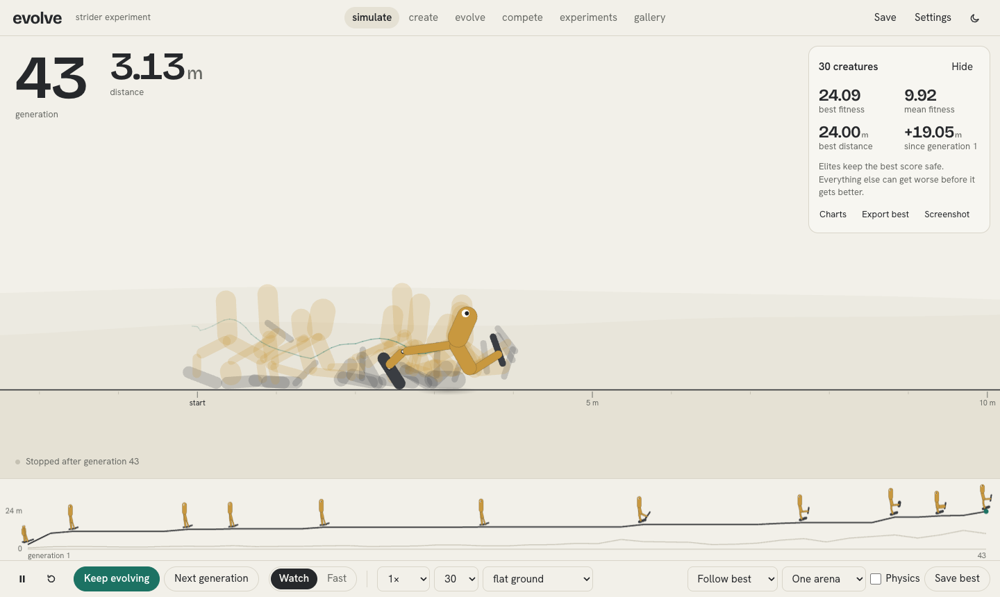
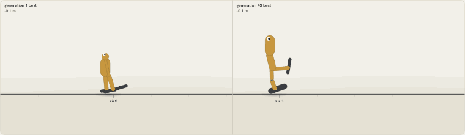
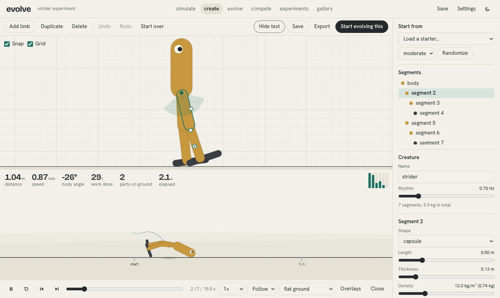
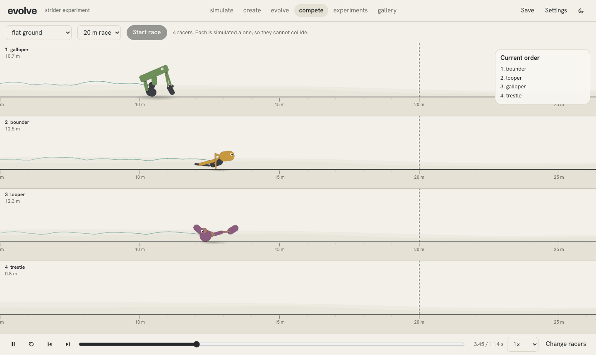
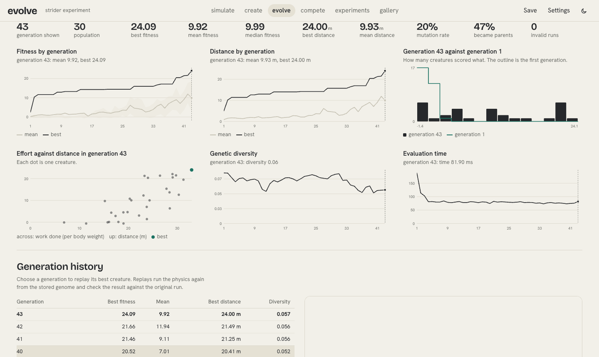
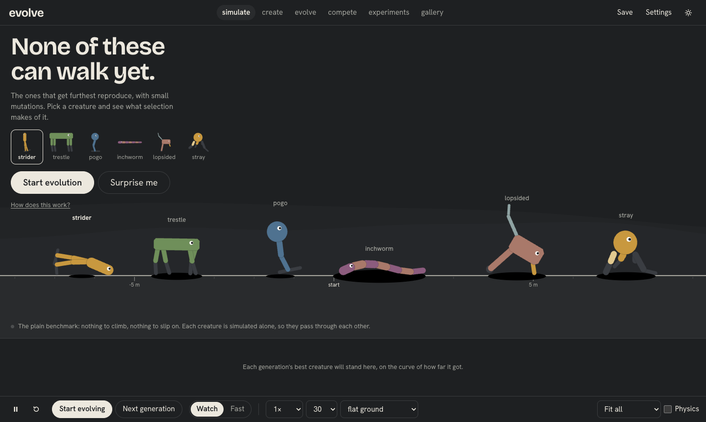

# evolve

An interactive artificial evolution and physics laboratory.

Watch artificial creatures learn to move through physics and evolution.

**Live Demo: [Launch evolve](https://evolve-creatures.vercel.app)**



Six creatures that cannot walk. Press start. The ones that get furthest reproduce, with mutations, and within a minute something strange starts to work.

Nothing is animated by hand. Every movement comes from torque-limited motors pushing rigid bodies through a real 2D physics engine, and every score is measured from what those bodies actually did. It runs entirely in the browser, with no account, no server and no install.



## What you can do

- **simulate:** watch a population try to cross the terrain, in one arena or as tiled arenas. Watch each generation, or run flat out and see the newest champion.
- **create:** build organisms in a drag-and-drop editor with handles, snapping, undo and redo, and real properties for every segment and motor. Every slider reaches the simulation. Test with live measurements and physics overlays, then evolve your creation.
- **evolve:** configure the genetic algorithm. Inspect charts, browse every generation, replay any champion, and compare any two creatures with a gene-by-gene difference. Branch new experiments from past generations.
- **compete:** race two to eight creatures to a finish line, in lanes, with a slow-motion replay.
- **experiments:** change one variable, repeat across seeds, and get aggregate results that decline to over-claim.
- **gallery:** save, rename, duplicate, export, import and share creatures. A share link carries the whole creature inside the URL.

| | |
| --- | --- |
|  |  |
|  |  |

## Does it actually work?

`npm run prove` runs the real genetic algorithm on the real physics, headlessly, and prints what happened. Results for 40 generations of 30 creatures on flat ground, with three seeds each (full output in [docs/proof.txt](docs/proof.txt)):

| Creature | Body | Starting distance | Generation 40 best, by seed |
| --- | --- | --- | --- |
| strider | two legs | 1.38 m | 33.25, 25.47, 24.74 m |
| trestle | four legs | 3.84 m | 21.14, 41.90, 38.39 m |
| pogo | one leg | -0.77 m | 35.15, 31.32, 26.51 m |
| inchworm | segmented | -2.28 m | 33.49, 17.88, 30.29 m |
| lopsided | asymmetric | -3.51 m | 28.15, 25.00, 24.77 m |
| stray | random | -0.15 m | 23.28, 22.90, 29.11 m |

The spread between seeds is the point: the process is stochastic, and one run proves little. Unit tests also require that a strider and a neural-controlled trestle improve on real physics, and that the algorithm beats random search with the same budget in the inchworm test case.

### Fixing a reward hack I only found by watching

The first version scored plain forward distance. The numbers looked excellent. Then a contact sheet of the actual gaits showed that creatures were toppling over in the first second and rowing along on their bellies at 3 m/s, upright 2% of the time. That is legal physics, and a useless result.

The fix is a measured term: forward distance earned while the main body is dragging on the ground is discounted by 75%. With the same algorithm, body drag fell to between 0% and 16% in the table above, the biped stayed upright for 79% to 99% of the run, and gaits appeared. Creatures still find ways to hop and bound, because it is a score to game and not a script to follow.

Other exploits are closed by construction and tested in `tests/unit/evolution.test.js`: vibration (frequency and motor speed are bounded, and neural commands pass through an 80 ms low-pass filter), toppling for credit (a settling phase before measuring, and centre-of-mass displacement rather than the leading edge), and solver abuse (runs that break speed, spin or joint limits are invalid and score below any valid run).

## How it works

### Separation of concerns

```
genome  →  phenotype  →  physics instance  →  measurements  →  fitness
(data)     (geometry)    (planck, in a worker)  (metrics)       (score)
```

The UI thread never runs physics. Workers simulate a creature and return either metrics, for evolution, or a recording, for display. The arena only ever plays recordings, interpolating between real solver states. That gives scrubbing, slow motion and frame stepping everywhere for free, and it means nothing on screen can be anything other than what the physics did.

### Physics

I benchmarked three engines on the same motor-driven seven-body walker (`benchmarks/engines.mjs`):

- **Matter.js** was fastest, but has no revolute motors or joint limits, so it cannot express this problem without faking actuation.
- **Rapier** (deterministic build) was equally fast, with lower joint error, but adds 3.3 MB of WASM and its JS API does not report the torque a motor applied.
- **planck** (Box2D in pure JavaScript) has real torque-limited motors that report their torque, so energy is a true measurement, and swept collision against terrain. It runs in workers with no WASM. Chosen.

The timestep came from measurement too (`npm run benchmark`). At 120 Hz with 8 velocity and 3 position iterations, 99th-percentile joint separation on a 15 N·m walker is 0.7 mm, for about 21 ms per 15 simulated seconds on an Apple M4 Pro. Controllers run at 60 Hz.

Units are SI throughout. A capsule is a box plus two half-density circles, so its collision shape and mass are exactly right, and the renderer draws the same outline the solver collides with. Limbs occupy parallel planes: they collide with terrain but not with each other, which removes a large class of instability.

### Determinism

Runs are bit-identical. ECMAScript leaves `Math.sin`, `cos` and `atan2` implementation-defined, and a chaotic contact simulation amplifies a last-bit difference into a different outcome, so `src/physics/deterministicMath.js` installs ports of fdlibm before planck loads. Basic IEEE arithmetic is exact everywhere, and that is all they use.

`tests/e2e/determinism.spec.js` simulates oscillator and neural creatures on several terrains in Chromium, Firefox and WebKit workers, and requires final-state hashes, distance and energy to match a reference computed in Node, exactly. Every replay in the app also checks its result against the original run and says so.

### Genome

Plain, versioned JSON, with a bounds table covering every parameter:

- **Body:** a rooted tree of up to 16 segments (capsule, circle or box), with dimensions, density, friction and restitution.
- **Joints:** normalised anchors, rest angle, limits, motor torque and speed, gain, damping.
- **Controller:** per-joint oscillator genes, or neural weights.

Anchors are normalised to the segment's extents, so resizing a body moves its attachments with it, and mutation cannot disconnect anything.

### Controllers

**Oscillators:** `target = offset + direction × amplitude × sin(2π × frequency × harmonic × t + phase)`.

**Neural networks:** a small feed-forward net with one tanh hidden layer. Inputs are a clock (sin and cos of an evolved frequency), body angle, spin, each joint's angle and speed, and ground contact at each leaf segment, all normalised to [-1, 1]. Outputs are one target angle per joint. Weights are genes.

Both produce only a target angle for a motor. A proportional controller turns the error into a commanded speed, and the solver applies whatever torque that takes, up to the joint's limit. Bodies are never positioned directly.

### Genetic algorithm

Each generation: evaluate, rank, keep elites, select parents, recombine, mutate.

- **Selection:** tournament (configurable size), linear rank (configurable pressure), or roulette.
- **Elitism:** elites are exact copies carrying their measured result, so they cost nothing to keep and cannot pick up a mutation by accident.
- **Crossover:** only between identical body graphs. Each joint's genes move as a block, since half of one gait and half of another is rarely either. Incompatible parents fall back to mutation.
- **Mutation:** Gaussian perturbation, uniform reset, rare discrete changes to rhythm and direction, and optional limb gain or loss. All bounded. No offspring is ever a silent clone.
- **Reproducibility:** all randomness comes from generators seeded by experiment and generation, so results do not depend on worker count or the order evaluations finish in. Resuming from a checkpoint continues identically to never having stopped, which is tested.

### Fitness

Default: `distance × (1 − 0.75 × bodyDrag) + 0.4 × upright − 0.008 × energy − invalid penalty`, where energy is mechanical work divided by body weight. Also selectable: top speed over three seconds, energy efficiency, upright walking and highest jump. They evolve visibly different animals, and every weight is adjustable.

## Performance

Measured in the production build with `scripts/measure.mjs`, on an Apple M4 Pro with 8 workers, in headless Chromium:

| Population | Generations | Time | Evaluations per second | Frame time, median and p99 |
| --- | --- | --- | --- | --- |
| 30 | 30 | 2.5 s | 345 | 16.7 ms, 16.8 ms |
| 100 | 30 | 9.1 s | 329 | 16.7 ms, 16.8 ms |

Your numbers will differ. The settings page reports throughput measured on your device. The pool is bounded and adapts to the device's core count and memory, jobs are batched to limit messaging, each evaluation builds a fresh world, and recordings use transferable typed arrays. Long-running history drops per-individual detail so memory stays bounded.

## Tech stack

React, Vite and JavaScript (no TypeScript). planck for physics, Web Workers for parallelism, Canvas 2D for rendering, hand-written SVG charts, Zustand for state, GSAP for interface motion only (never creatures), IndexedDB for storage, Vitest and Playwright for tests.

## Running it

```bash
git clone https://github.com/yoonmax/evolve.git
cd evolve
npm install
npm run dev
```

Then open http://localhost:5240.

```bash
npm test                # 157 unit and integration tests
npm run build && npm run preview
npm run test:e2e        # 37 browser tests against the production build
CROSS_BROWSER=1 npm run test:e2e   # also Firefox and WebKit
BASE_URL=https://evolve-creatures.vercel.app npm run test:e2e   # against the live site
npm run prove           # evolve every starter headlessly and print the results
npm run lint
```

`scripts/filmstrip.mjs` lays an evolved champion's gait out as a contact sheet: the tool that exposed the reward hack above. `scripts/build-examples.mjs` regenerates the gallery's evolved examples, and a test re-simulates each one to check it still achieves exactly what its label claims.

## Deployment

It is a static site, deployed to Vercel from the CLI:

```bash
npx vercel deploy --prod
```

## What this is not

This is artificial evolution: a genetic algorithm searching over simulated bodies and controllers. It does not model biological evolution in its full complexity. Fitness is defined by the application or the user, not by survival. The physics is an approximation. The process is stochastic, improvement is not guaranteed in any generation, and populations often converge early on a mediocre gait. Creatures exploit whatever the score leaves open. The neural controllers are small, simplified models.

## Known limitations

- Two dimensions only, with no self-collision, and bodies must be trees: closed-loop linkages are not supported.
- No moving platforms; terrain is static.
- Cross-engine determinism was verified on one machine with Chromium, Firefox and WebKit builds. It has not been tested on other CPU architectures or on real phones.
- Saved results are tied to the physics version. Changing the solver settings changes outcomes, so replays of old creatures would show the new behaviour, and the replay check reports the mismatch.
- Experiments comparing population sizes hold generations equal, not evaluations, so larger populations get a bigger budget.
- Share links round genes to five decimals, so a shared creature is re-simulated rather than replayed, and can differ slightly from the original run.
- The mobile editor works but is cramped; the desktop layout is the flagship experience.

## License

MIT
